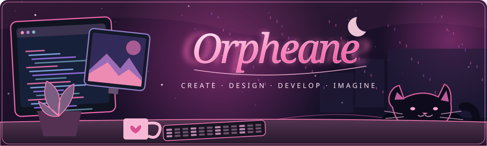
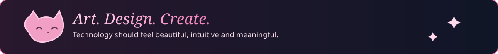

  

 

# Hello, fellow developers! :) ♡

**My name is Orpheane**

💗 CREATIVE DEVELOPER &nbsp; | &nbsp; INDIE MAKER &nbsp; | &nbsp; DIGITAL ARTIST

<table>
<tr>
<td width="68%" valign="top">

I'm a creative mind who loves turning ideas into things people can actually use. I blend **art, imagination, and technology** to create useful tools, browser extensions, web experiences, and playful digital projects.

My journey started with music, photography, and visual design. Today, I learn by building, experimenting, and exploring AI-assisted development. I care about thoughtful details, intuitive interfaces, and projects with their own personality.

</td>
<td width="32%" valign="top">

**♡ Creative ideas**  
That solve real problems

**✧ Thoughtful design**  
In every detail

**⌘ Personal technology**  
Built with curiosity

**☆ Playful experiences**  
Made to feel enjoyable

</td>
</tr>
</table>

## 🌸 Selected projects

A few things I've created with curiosity, care, and a love for beautiful everyday experiences.

<table>
<tr>
<td width="33%" valign="top" align="center">

**[Perfect Ear EQ](https://github.com/Orpheane/perfect-ear-eq)**

*Your sound. Your way.*

A free Chrome audio extension with real-time equalization, presets, and personalized listening controls.

🎵 AUDIO &nbsp; · &nbsp; CHROME EXTENSION

[Chrome Web Store](https://chromewebstore.google.com/detail/perfect-ear-eq/kigpbihaamfjdieahgdboignbjgohbbi) · [GitHub](https://github.com/Orpheane/perfect-ear-eq)

</td>
<td width="33%" valign="top" align="center">

**Cozy Aquarium**

*Productivity in a peaceful underwater world.*

A cozy extension that makes daily tasks more motivating through gentle gamification.

🐠 PRODUCTIVITY &nbsp; · &nbsp; GAMIFICATION

[Become a tester](https://groups.google.com/g/cozy-aquarium) · [Learn more](https://orpheane.github.io/#projects)

</td>
<td width="33%" valign="top" align="center">

**Rifty**

*Community, web, and Discord together.*

A collaborative web platform connected to a Discord bot (Owner: **[toskaman](https://github.com/toskaman/)**), bringing community features into one interactive experience.

💻 WEB APP &nbsp; · &nbsp; COMMUNITY

[Explore the project](https://orpheane.github.io/#projects)

</td>
</tr>
</table>

  <a href="https://github.com/Orpheane?tab=repositories">See all my repositories</a>
  &nbsp; · &nbsp;
  <a href="https://orpheane.github.io/">Explore my creative portfolio</a>

 

  Made with imagination, curiosity, and a little bit of code. ♡

